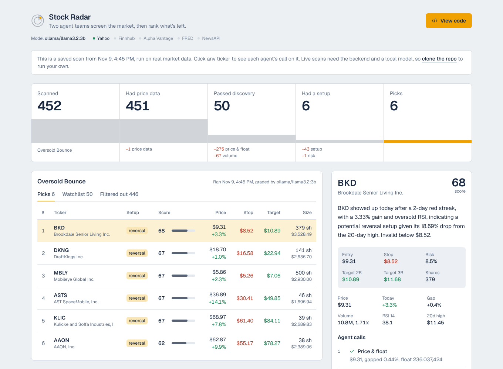

# Stock Radar

A multi-agent stock screener. Two teams of small agents work through a list of tickers: the Discovery team filters on price, float, volume and news catalysts, and the Analysis team looks for momentum, breakout and reversal setups, builds a trade plan and ranks what's left. A FastAPI backend runs the scans and a React dashboard shows the results, including why every dropped ticker was dropped.

**[Live demo](https://khalilshots.github.io/stockRadar/)**, a saved scan you can click through.



*From a real Oversold Bounce scan on November 9, 2026, graded by Llama 3.2 3B running locally.*

## How a scan works

```
universe (up to 500)
  -> Discovery team:  price & float -> volume -> catalyst        -> watchlist (up to 50)
  -> Analysis team:   momentum, breakout, reversal -> risk        -> candidates
  -> scoring                                                      -> picks (up to 10)
```

1. Universe. Tickers come from Yahoo's predefined screens (day gainers, small cap gainers, most active), or from a list you pass in.
2. Market data. One batched yfinance download gets six months of daily bars. Indicators are computed in code: RSI, ATR, 20/50-day averages, 20-day high and low, gap, relative volume.
3. Discovery team. Each agent returns `{ticker, agent, passed, reason, source, data}`. A gate runs after every agent and drops the ticker on a fail, an error or missing data. Agents run cheapest first, so the float lookup (a network call) only happens for tickers that already passed the price checks, and the catalyst agent (news API plus LLM) only sees tickers that are actually trading.
4. Analysis team. The three setup agents look at every watchlist ticker. A setup gate keeps the ticker if it shows a setup the strategy wants. The risk agent then sizes the trade: stop at 1.5 ATR below entry, position sized so a stop-out loses exactly the strategy's dollar risk, targets at 2R and 3R, size halved when the VIX is elevated.
5. Scoring. A weighted score (setup 50%, catalyst 20%, relative volume 15%, news sentiment 15%) ranks the candidates. Alpha Vantage sentiment is only fetched for the top few, since the free tier allows 25 calls a day. The LLM writes a short note for each final pick.

Every agent result is saved in the scan, so you can see each agent's call on any ticker in the dashboard.

## Where the LLM fits

LLM calls go through the LiteLLM SDK directly, not an agent framework. The default is a local Llama 3.2 3B on Ollama at temperature 0, and any LiteLLM model string works.

- Plain comparisons stay in code. Price, float and volume checks and the risk math are deterministic. A model has no business deciding whether 6.40 is between 2 and 20.
- The LLM does the judgment calls. It reads headlines to decide whether there's a real catalyst or a dilutive offering, grades how clean a setup is, and writes the trade note.
- The model can't contradict the numbers. A setup agent only asks the model to grade a breakout after the rules confirm price is above the 20-day high. The model can veto a setup or score it, but it can't invent one.
- Replies are validated. Every reply is parsed and checked against a Pydantic schema. If the model is down, slow or returns junk, the agent falls back to its rule-based answer and the result is tagged `rules` instead of `llm`. After one connection failure, the rest of the scan skips the model instead of waiting on a timeout per ticker.

## Data sources

| Source | Used for | Key needed |
|---|---|---|
| yfinance | universe screens, daily bars, float and company info | no |
| Finnhub | company news for the catalyst agent (60 calls/min) | yes |
| NewsAPI | backup news source (100 calls/day) | yes |
| Alpha Vantage | news sentiment for the top candidates (25 calls/day) | yes |
| FRED | VIX level for the market regime | yes |

Every key is optional. Without news keys the catalyst check is skipped, and without FRED the risk agent assumes a normal market. Responses are cached on disk and daily budgets are tracked in `backend/data/usage.json`.

## Setup

Needs Python 3.10+, Node 20+ and [Ollama](https://ollama.com) if you want the LLM.

```bash
git clone https://github.com/khalilshots/stockRadar.git
cd stockRadar/backend

python -m venv .venv
source .venv/bin/activate
pip install -r requirements.txt
cp .env.example .env        # add whichever keys you have

ollama pull llama3.2:3b     # optional, set LLM_MODEL=none to run on rules only
```

## Running it

### From the terminal

```bash
cd backend
python run.py                                   # default strategy, Yahoo screens
python run.py --strategy "Oversold Bounce"
python run.py --tickers SOFI HOOD PLTR -v       # your own list, with logs
```

### API

```bash
cd backend
uvicorn main:app --reload                       # http://localhost:8000/docs
```

Set `SCHEDULER_ENABLED=true` in `.env` to run the default strategy on weekdays at 9:00, 16:30 and 22:00 Eastern.

| Method | Path | |
|---|---|---|
| GET | `/api/status` | model, connected sources, remaining daily budgets, next scheduled scans |
| GET / PUT / DELETE | `/api/strategies` | list, add or update, remove strategies |
| POST | `/api/scans` | start a scan, `{"strategy": "...", "tickers": [...]}` |
| GET | `/api/scans`, `/api/scans/latest`, `/api/scans/{id}` | results, including every drop and its reason |
| GET | `/api/scans/{id}/tickers/{ticker}` | every agent's call on one ticker |

### Dashboard

```bash
cd frontend
npm install
npm run dev                                     # http://localhost:5173
```

The dev server proxies `/api` to the backend on port 8000.

### Updating the live demo

The demo on GitHub Pages is the dashboard built in demo mode, reading one saved scan instead of the API.

```bash
cd backend
python run.py
python export_demo.py      # writes frontend/public/demo-scan.json
git add ../frontend/public/demo-scan.json && git commit -m "update demo scan" && git push
```

Pushing anything under `frontend/` rebuilds and redeploys it through `.github/workflows/demo.yml`.

### Tests

```bash
cd backend
pytest
```

The tests use fake market data and a fake model, so they run offline with no keys.

## Strategies

Strategies live in `backend/strategies/strategies.json`. Two come with the repo: Small Cap Momentum and Oversold Bounce.

```json
{
  "id": "1",
  "name": "Small Cap Momentum",
  "criteria": {
    "price_min": 2,
    "price_max": 20,
    "max_float": 10000000,
    "min_volume": 50000,
    "min_relative_volume": 1.5,
    "min_gap_percent": 10,
    "max_prior_day_gain": 40,
    "require_catalyst": true
  },
  "setup_preferences": ["momentum", "breakout"],
  "risk_per_trade": 500,
  "universe": ["small_cap_gainers", "day_gainers", "most_actives"]
}
```

## Project layout

```
backend/
  main.py                 FastAPI app
  run.py                  terminal scans
  scan_runner.py          runs one scan at a time in the background
  scheduler.py            weekday scans
  agents/
    orchestrator.py       the pipeline
    team1/                price_filter, volume_agent, catalyst_agent
    team2/                momentum, breakout, reversal, risk, scoring
  tools/                  one module per data source
  utils/                  gates, indicators, llm, cache, rate limiter, scan store
  strategies/             strategies.json and the strategy model
  config/settings.py      settings from .env
  tests/
frontend/
  src/components/         funnel, tables, ticker detail
  src/components/ui/      shadcn/ui components
```

## Limits

- Daily bars only. During market hours the last bar is today so far, so relative volume is low early in the session.
- Yahoo data is unofficial and can be throttled. Fundamentals are cached for 12 hours.
- A 3B model is fast on a laptop but not a strong analyst. That's why it grades and explains, and the rules decide.

This is a personal research project, not financial advice.
